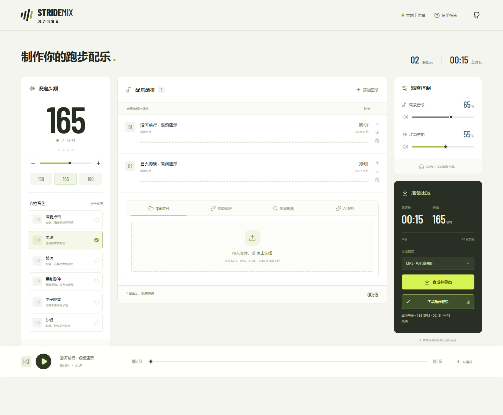

# StrideMix

为自己的跑步制作配乐。把喜欢的音乐排成播放顺序，再叠加一条独立的步频节拍，试听后导出为 MP3 或 WAV。



## 功能

- 设置 60–240 步/分钟，一步一响，默认 165。
- 六种节拍音色，可单独试听。换歌时保持节拍连续。
- 上传音频或视频、导入支持的视频链接、搜索歌名后选择版本。
- 使用自己的 ElevenLabs API Key 生成纯音乐。
- 调整曲目顺序、移除曲目，自动计算跑步配乐总时长。
- 独立调节 BGM 和节拍音量，播放、暂停、跳转试听。
- 后台导出 MP3 或 WAV，显示进度，支持取消与下载。
- 素材留在本地，刷新页面后恢复项目设置与曲目顺序。

## 快速开始

需要 Python 3.11+，以及 Node.js 22.12+。首次安装需要联网下载依赖。

```bash
git clone https://github.com/Jocelyn-2005/stridemix.git
cd stridemix
python start.py
```

启动器会建立项目专用的 `.venv`、安装 Python 依赖、构建前端，然后打开浏览器。Windows 也可双击 `start.bat`。无需单独安装 FFmpeg，程序会使用 `imageio-ffmpeg` 随包提供的可执行文件。

默认地址为 `http://127.0.0.1:8765`。关闭服务时在终端按 Ctrl+C。

```bash
python start.py --setup
python start.py --no-browser --port 8766
```

`--setup` 重新安装依赖并构建界面，适合更新源码后使用。`--no-browser` 关闭自动打开浏览器。

## 使用

1. 上传音乐文件，或在导入窗口中输入视频链接、搜索歌名。
2. 选择搜索结果中的具体版本，导入后调整播放顺序。
3. 设置步频和节拍音色，调节两个音轨的音量。
4. 试听，选择 MP3 或 WAV，开始导出并下载。

例如两首分别为 4 分钟和 6 分钟的音乐，会得到约 10 分钟的跑步配乐。165 步/分钟会在这条时间线上持续响起，BGM 保持原来的速度。

### AI 配乐

把 `.env.example` 复制为 `.env`，填入自己的 `ELEVENLABS_API_KEY`，重启程序即可启用。使用提示词描述音乐风格与时长，生成结果会加入素材列表。此功能调用真实的 ElevenLabs Music API，服务商可能要求付费额度。密钥由本地后端读取。生成时会把提示词发送到 ElevenLabs。[API 文档](https://elevenlabs.io/docs/api-reference/music/compose)

### 歌名和视频链接

歌名搜索使用 YouTube 搜索结果。链接导入使用 yt-dlp，因此支持情况受站点、网络、地区及登录状态影响。遇到无法访问的来源，可使用本地文件导入。请遵循音频来源的许可和平台使用条件。[支持的站点](https://github.com/yt-dlp/yt-dlp/blob/master/supportedsites.md)

## 开发

```bash
python -m venv .venv
```

激活环境后运行

```bash
python -m pip install -r requirements.txt
python -m uvicorn backend.app:app --host 127.0.0.1 --port 8765 --reload
```

在另一个终端运行

```bash
cd frontend
npm ci
npm run dev
```

Vite 开发服务把 `/api` 转发至本地后端。生产模式由 FastAPI 直接提供 `frontend/dist`。

### 验证

```bash
python -m pytest backend/tests tests -q
cd frontend
npm test
npm run build
```

测试覆盖绝对采样节拍位置、音色、独立音量与实际音频导出。长音频采用磁盘文件和分块处理，避免将完整混音加载到浏览器内存。WAV 的采样时长可精确验证，MP3 播放器显示时长可能包含编码补齐。

2026-11-15 已在 Windows 上验证本地音频与视频上传、真实 YouTube 搜索和链接导入、浏览器排序与跨曲播放、WAV/MP3 下载，以及 390px 手机宽度布局。30 分钟 MP3 导出经重新解码，时长准确为 1,800 秒。165 步/分钟的 30 分钟节拍时间线包含 4,950 次提示。AI 接口已验证请求格式和错误处理，真实生成需要用户自己的有效密钥和额度。

## 文件与许可

运行素材、元数据和导出保存在 `data/`，该目录与 `.env` 已排除在 Git 提交之外。节拍音色由项目算法生成。音色设计参考了点击声和木块敲击的公开资料，可继续扩展采样音色。[CC0 点击声参考](https://freesound.org/people/trader_one/sounds/684106/) · [CC0 木块声参考](https://freesound.org/people/hollandm/sounds/692828/)

项目代码与内置合成音色采用 MIT 许可。第三方依赖使用各自的许可证，FFmpeg 构建许可由所使用的发行包决定。
