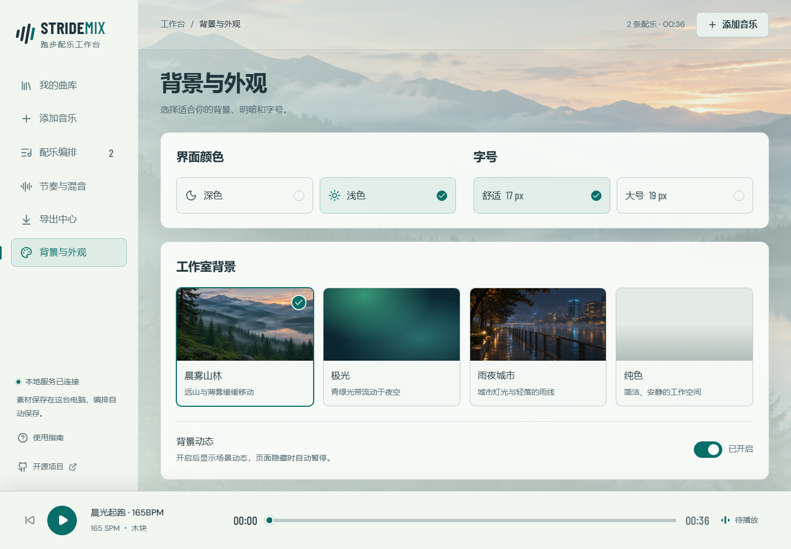
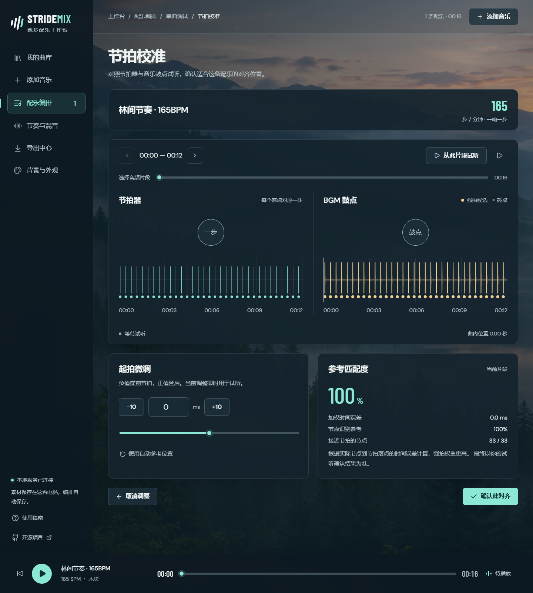

# StrideMix

为自己的跑步制作配乐。把喜欢的音乐排成播放顺序，再叠加一条独立的步频节拍，试听后导出为 MP3 或 WAV。


## 功能

- 设置 60–240 步/分钟，一步一响，默认 165。
- 六种节拍音色，可单独试听。每首按该曲鼓点位置重新起拍。
- 上传音频或视频、导入支持的视频链接、搜索歌名后选择版本。
- 从实际音频自动识别音乐节奏、鼓点与起拍，节拍器每响对应一步。
- 独立可视化校准页，左右对照节拍器与 BGM 波形、鼓点及强拍候选，试听后确认起拍偏移。
- 基于当前片段实际节点的时间误差提供参考匹配度，弱鼓点素材显示证据不足。
- 按当前步频制作变速保调版，试听后导出，可恢复原版。
- 曲间默认静音 2 秒，可调间隙长度，每曲支持毫秒级节拍校正。
- 使用自己的 ElevenLabs API Key 生成纯音乐。
- 调整曲目顺序、移除曲目，自动计算跑步配乐总时长。
- 曲库素材支持删除，确认界面列出关联变速版本及受影响的编排条目。
- 曲库只展示从“添加音乐”导入的原曲，变速处理结果作为编排缓存用于试听和导出。
- 独立调节 BGM 和节拍音量，播放、暂停、跳转试听。
- 后台导出 MP3 或 WAV，显示进度，支持取消与下载。
- 素材留在本地，刷新页面后恢复项目设置与曲目顺序。
- 独立的曲库、编排、单曲调试、节奏混音与导出页面，底部播放器持续可用。
- 可切换深色／浅色主题、舒适／大号字体，以及山林、极光、雨夜城市和纯色背景。
- 可上传当前浏览器专用壁纸，选择黑体、宋体、圆体或等宽字体；底部播放键进入沉浸试听，人物保持居中并按一拍一步行走。
- 变奏歌曲会遍历全曲分段分析，按可靠的局部节奏制作保留音高的适配缓存，并在试听中显示当前倍速、局部时序微调和处理后残差参考。
- 背景动态可关闭，遵循系统减少动态效果设置，页面隐藏时暂停。

## 快速开始

需要 Python 3.11+，以及 Node.js 22.12+。首次安装需要联网下载依赖。

```bash
git clone https://github.com/Jocelyn-2005/stridemix.git
cd stridemix
python start.py
```

启动器会建立项目专用的 `.venv`、安装 Python 依赖、构建前端，然后打开浏览器。Windows 也可双击 `start.bat`。无需单独安装 FFmpeg，程序会使用 `imageio-ffmpeg` 随包提供的可执行文件。

默认地址为 `http://127.0.0.1:8765`。关闭服务时在终端按 Ctrl+C。

```bash
python start.py --setup
python start.py --no-browser --port 8766
```

`--setup` 重新安装依赖并构建界面，适合更新源码后使用。`--no-browser` 关闭自动打开浏览器。

## 使用

1. 进入“添加音乐”，上传文件、输入视频链接、搜索歌名或生成 AI 配乐。导入结果加入曲库和当前编排，曲库中的素材也可再次加入编排。
2. 进入“配乐编排”调整顺序和曲间间隙。点击曲目的“单曲调试”，查看自动识别结果，按需适配当前步频，或进入“可视化校准”对照鼓点试听。
3. 在“节奏与混音”设置目标步频、试听节拍音色，调整背景音乐与节拍的独立音量。
4. 使用底部播放器试听、暂停或跳转，切换页面和外观时可继续播放。
5. 进入“导出中心”，核对参数，选择 MP3 或 WAV，开始导出并下载。

“背景与外观”提供深浅主题、两档字号和四种场景。晨雾山林与雨夜城市使用随项目提供的原创场景图片，叠加薄雾或雨线动画，极光使用 CSS 光带动画。外观选择保存在当前浏览器中。动态开关只控制背景效果。

上传壁纸只保存在当前浏览器的 IndexedDB 中，不会进入曲库或 GitHub。底部播放键会平滑打开沉浸试听场景，人物锁定在画面中央，地面按真实播放位置后移；暂停、拖动、曲间静音间隙和系统减少动态效果都会同步反映。试听信息中的“当前倍速”是音频处理倍率，不是 BPM；“时序微调”表示相对局部变速方案的正负修正，不是设备延迟。



例如两首分别为 4 分钟和 6 分钟的原速音乐，加上默认曲间间隙后，总时长约为 10 分 2 秒。节拍在各曲内部按设定步频播放。制作变速版后，总时长会根据实际音频重新计算。

### 起拍与曲间间隙

默认相邻曲目之间加入 2 秒静音，总时长包含这些间隙。下一首使用自身的鼓点起拍位置重置节拍，音乐与节拍共用音频时钟。每曲的节拍尾音在该曲结束处截断。

可视化校准页左侧展示节拍器打点，右侧展示从当前音频片段提取的包络、鼓点和低频强拍候选。两侧共用试听时间线，可以选择片段、试听、按 10 毫秒按钮或滑块微调。正值延后节拍，负值提前。微调即时用于试听，点击“确认此对齐”后保存到该条编排，取消调整会恢复已保存的起拍位置。试听与导出使用同一套已确认的偏移和间隙设置。

参考匹配度优先采用当前片段中数量充分的低频强拍候选，显示主要节奏落位的时间误差。切分和装饰鼓点保留自然位置，分数用于试听时参考整体起拍。鼓点证据不足时显示“证据不足”。最终由用户结合试听确认。



### 自动节奏识别与变速

本地文件、视频链接和歌名搜索导入的音乐使用同一套音频分析流程。程序抽取有界片段估算 BPM 和起拍，并自动处理节奏识别中常见的倍速关系。日常操作只需设置跑步步频，可以点击“重新自动识别”重新提取鼓点。历史手动 BPM 在选入编排后会重新采用音频分析结果。

点击“适配当前步频”时，程序自动选择接近目标的节奏关系并进行变速保调。例如 120 BPM 的音乐适配 165 步/分钟时，倍率约为 1.375，一首 20 秒的音乐会变成约 14.55 秒。

如果歌曲中途出现变奏，程序会以 12 秒分析窗遍历全曲，并用相邻可靠节奏节点建立平滑的源音频到输出音频时间图。处理边界放在主要攻击之间，使用保留音高的 rubberband（不可用时回退到 atempo）和短交叉淡化，避免把每个装饰鼓点硬吸附到节拍器。适配详情页的分段图可以点击跳转，低证据段落会用斜纹标出。处理后的音频会再次测量，页面显示覆盖率和残差参考；证据不足时保留“待确认”，不虚构精度。

音乐采用半速、原速或倍速关系中相对原曲改动较小的一档。例如 40 BPM 音乐配合 170 步/分钟，可以变为 85 BPM，速度倍率为 2.125，节拍器每分钟继续提示170次。界面分别显示音乐目标 BPM、变速倍率和节拍器步频，保留音乐内部的强弱拍、切分与装饰节奏。

曲目上的制作按钮采用页面当前步频作为目标，使用变速保调处理生成新音频。生成后，编排中的该项会使用新版本，试听和导出共用这一文件。可通过恢复原版入口切回最初音源。再次制作时会以最初音源和总倍率进行处理。[FFmpeg atempo 文档](https://ffmpeg.org/ffmpeg-filters.html#atempo)

### AI 配乐

把 `.env.example` 复制为 `.env`，填入自己的 `ELEVENLABS_API_KEY`，重启程序即可启用。使用提示词描述音乐风格与时长，生成结果会加入素材列表。此功能调用真实的 ElevenLabs Music API，服务商可能要求付费额度。密钥由本地后端读取。生成时会把提示词发送到 ElevenLabs。[API 文档](https://elevenlabs.io/docs/api-reference/music/compose)

### 歌名和视频链接

歌名搜索使用 YouTube 搜索结果。链接导入使用 yt-dlp，因此支持情况受站点、网络、地区及登录状态影响。遇到无法访问的来源，可使用本地文件导入。请遵循音频来源的许可和平台使用条件。[支持的站点](https://github.com/yt-dlp/yt-dlp/blob/master/supportedsites.md)

## 开发

```bash
python -m venv .venv
```

激活环境后运行

```bash
python -m pip install -r requirements.txt
python -m uvicorn backend.app:app --host 127.0.0.1 --port 8765 --reload
```

在另一个终端运行

```bash
cd frontend
npm ci
npm run dev
```

Vite 开发服务把 `/api` 转发至本地后端。生产模式由 FastAPI 直接提供 `frontend/dist`。

### 验证

```bash
python -m pytest backend/tests tests -q
cd frontend
npm test
npm run build
```

测试覆盖绝对采样节拍位置、音色、独立音量与实际音频导出。长音频采用磁盘文件和分块处理，避免将完整混音加载到浏览器内存。WAV 的采样时长可精确验证，MP3 播放器显示时长可能包含编码补齐。

2026-11-15 已在 Windows 上验证本地音频与视频上传、真实 YouTube 搜索和链接导入、浏览器排序与跨曲播放、WAV/MP3 下载，以及 390px 手机宽度布局。30 分钟 MP3 导出经重新解码，时长准确为 1,800 秒。165 步/分钟的 30 分钟节拍时间线包含 4,950 次提示。AI 接口已验证请求格式和错误处理，真实生成需要用户自己的有效密钥和额度。

新增节奏功能的完整套件包含 44 项 Python 测试和 17 项前端测试。已验证 82.5、120、165 BPM 合成音频、弱节奏识别、440 Hz 音高保持、连续变速、实际导出时长、历史素材补分析、重复素材的独立编排实例，以及手机端制作与恢复操作。真实歌名搜索选定的 YouTube 曲目也已通过导入后的自动分析。

逐曲起拍版本已验证不同首拍位置的自然跨曲、直接跳转第二首、间隙内跳转、毫秒与半拍校正、导出静音区间和分块等待时两轨同步暂停。独立合成音频的 173 ms、91 ms 首拍定位误差小于 1 ms。实际歌曲的起拍分析仍显示自身可靠程度，用户可结合听感微调。

2026-11-16 分层界面版本通过 85 项后端测试、35 项前端测试和 Chromium 实际操作验证。已检查七个页面的导航与刷新、切页持续播放、跨页适配任务、导出下载与取消，以及 1440px／390px 下两套主题和两档字号。默认采用深色晨雾山林、动态开启与 17px 舒适字号，可在外观页自选。Windows 下混音取消时的日志占用错误已通过真实 FFmpeg 回归与连续三次界面取消验证修复。

自动鼓点校准与曲库删除版本通过 112 项后端测试、42 项前端测试，以及真实 Chromium 导入、旧素材自动重分析、第二首起拍、左右节点对照、试听草稿、确认／取消、跨片段、变速、下载和素材关联删除验证。另以真实40 BPM音频验证170步频对应85 BPM音乐目标，并覆盖切分装饰鼓点的评分参考。已检查深浅主题和390px手机布局。纯音测试显示证据不足，已完成导出在源素材删除后可继续下载。

## 文件与许可

运行素材、元数据和导出保存在 `data/`，该目录与 `.env` 已排除在 Git 提交之外。节拍音色由项目算法生成。音色设计参考了点击声和木块敲击的公开资料，可继续扩展采样音色。[CC0 点击声参考](https://freesound.org/people/trader_one/sounds/684106/) · [CC0 木块声参考](https://freesound.org/people/hollandm/sounds/692828/)

项目代码、内置合成音色与原创生成背景采用 MIT 许可。背景使用内置图像生成工具制作，素材路径与完整提示词记录在设计方案中。[背景生成记录](docs/plans/2026-11-16-music-app-redesign.md#原创背景素材)

第三方依赖使用各自的许可证，FFmpeg 构建许可由所使用的发行包决定。
